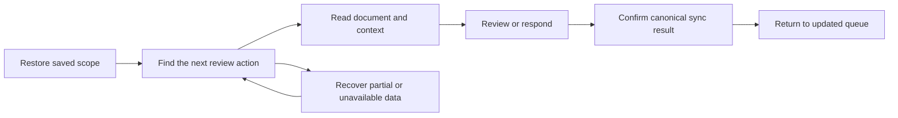
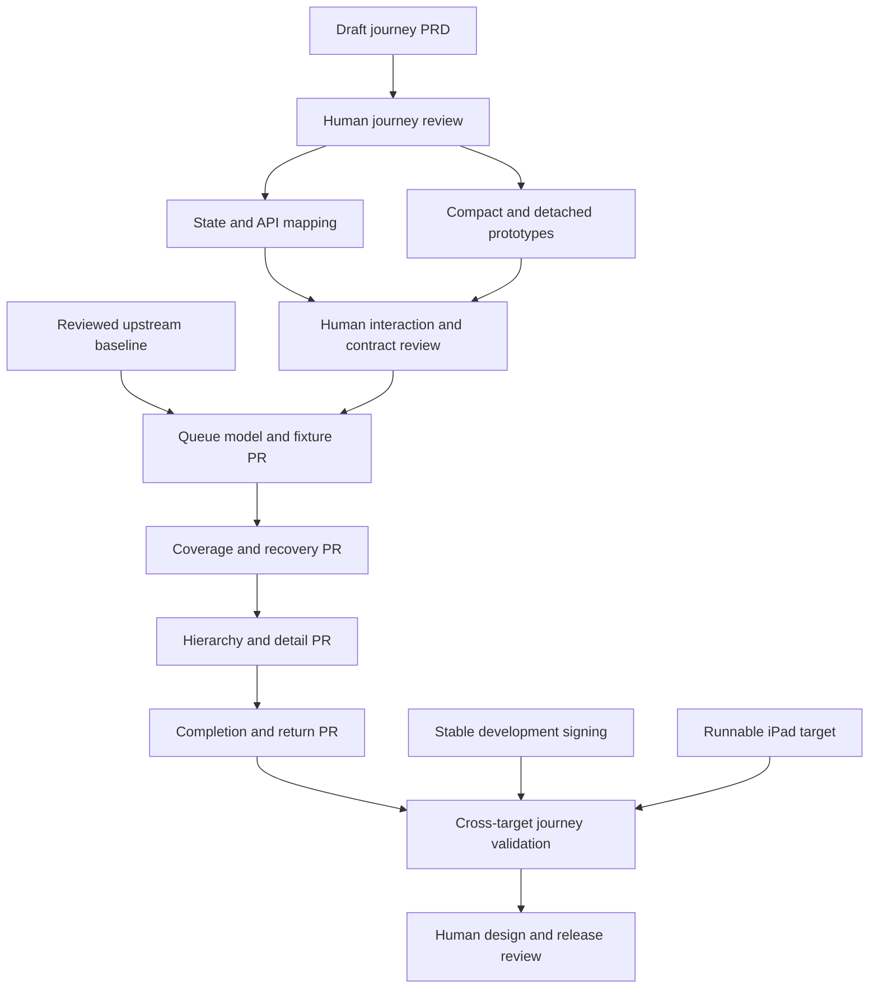

# Summary

Deliver a dashboard that helps users find their next document review, understand
whether the queue is current, and return after a confirmed action. Use small
supporting PRs and three human design reviews. This is a delivery proposal; it
does not approve a new layout or replace the forthcoming dashboard PRD.

Gantry workflow `wf-gen-thr7mb`, workstream `dashboard-journey`, holds the live
plan. It contains 14 pending tasks with dependency links. The workflow remains
`proposed`. The next concrete action is **D1: draft the dashboard journey PRD**.
Later tasks are provisional and must be revised as reviews resolve open questions.

# Motivation

[PRD-001](../prd/prd-001-hermit-rfc-collaboration-vision.md) defines document
collaboration, but not the dashboard journey.
[RFC-008](rfc-008-macos-menu-bar-app.md) describes an older single-repository
menu app, embedded Settings, and direct GitHub access. The current integration
candidate has multiple repositories and a standalone Settings window.
[ADR-009](../adr/adr-009-hermit-api-as-canonical-native-client-interface.md)
requires native clients to use the Hermit API.

The information-priority audit found several connected problems:

- Partial or cached results need clear coverage and recovery context.
- PR numbers do not establish priority across repositories.
- A document count above PR-grouped rows leaves the unit unclear.
- A merged badge does not explain why an item still needs review.
- Branches, file counts, diff sizes and diagnostics compete with the next action.

[RFC-005](rfc-005-label-driven-pr-rfc-discovery-and-commentability.md) permits
active review labels on closed PRs. Queue changes must preserve that re-review
path and distinguish workflow action, merge state and document lifecycle.

Success means an approved journey implemented through reviewed changes, tested
on the supported targets, with an exact stable-main SHA and rollback path.
Green CI alone does not establish usability or release readiness.

# Detailed Design

## Proposed journey and information order

The working hypothesis is a review-first default:



The proposed order is saved scope, trustworthy coverage, next action and document
title, then supporting context. Library browsing and Monitor retain secondary
access. Server ports and detailed diff metadata belong in those views or row
detail. Recovery becomes prominent when it prevents useful work.

R1 must decide whether reviewers or maintainers are the primary audience. A
health-first maintainer mode remains an alternative. Personalized assignment or
priority is out of scope unless the API supplies trustworthy signals.

## Stages and supporting PRs

| Stage | Gantry tasks | Reviewable result | Exit condition |
| --- | --- | --- | --- |
| Baseline | B0 | Review current upstream and integration PR #27 | Human-reviewed baseline, required checks, authorized merge and recorded main SHA |
| Product definition | D1, R1 | Draft PRD-002, RFC-008 reconciliation, scenario matrix | Human journey and information-priority review |
| Design and contracts | D2, D3, R2 | State/API mapping and annotated compact/detached prototypes | Human design and engineering review of feasible interactions |
| Supporting changes | P1, P2 | Separate model/fixture PR and coverage/recovery PR | Each reviewed, tested and merged before its dependent PR |
| Dashboard changes | P3, P4 | Separate hierarchy PR and completion/return-to-queue PR | Approved design implemented with meaningful regression evidence |
| Validation and adoption | O1, O2, V1, R3 | Stable test environment, cross-target evidence and release review | Explicit approval, tested main SHA, updated docs and rollback reference |

Design work can proceed while B0 remains open. Production implementation requires
both B0 and R2. Each implementation task is a separate intended PR; split further
if its scope grows. Branch from the reviewed current main after prerequisites
land. Do not stack unrelated feature work into the dashboard changes.



P1 isolates identity, eligibility, ordering, count units and freshness from view
rendering. Synthetic multi-account/team fixtures make later design checks
repeatable without accessing credentials. P2 makes cached and partial results
honest and directs recovery to the affected account. P3 changes hierarchy and
density using the approved prototypes. P4 connects existing supported actions
to accurate pending, success and failure states and restores queue context.

If a required review action is missing, P4 triggers a new scope review. It must
not silently grow a new commenting or approval subsystem.

## Review protocol

R1, R2 and R3 are distinct `review` tasks tagged `human-review-gate`. Their
dependents have real Gantry `blocked_by` links. B0 is also a human review gate.
The operator must attach the reviewer, artifact revision, decision and remaining
conditions before completing a gate. A gate is not complete because its draft
exists or an automated check passes. Requested changes keep dependents blocked.

The CLI dependency links enforce sequencing, not reviewer identity or approval
provenance. The human approval rule is an operating requirement in the task
descriptions. No worker spawner or automatic approval service is started by this
setup. Material changes after approval require a fresh review task linked as a
blocker before dependent work continues.

## Validation contract

D1 must define success measures and R1 must approve their thresholds before
implementation: successful next-action selection, time to identify that action,
correct understanding of coverage, and correct understanding of submission state.
Collect a current-layout baseline using the same scenarios; do not claim an
improvement without measurements.

The evidence matrix includes multi-repository PR-number collisions, several
documents in one PR, closed-PR re-review, saved team/repository scope, true empty
and partial empty queues, cached/offline results, auth failures, rate limits,
cancellation, delayed sync and failed writes. Check compact and detached macOS,
iPad, keyboard navigation, VoiceOver and existing/new Settings windows. Attach
build SHA, device/OS, screenshots and results. Use synthetic fixtures first and
only then the minimum live validation needed.

## API Changes

This planning change introduces no product API changes. D2 inventories existing
signals in `api/openapi/v1/openapi.yaml` and records gaps. Any required additive
contract change belongs in a reviewed supporting PR, with compatibility and
tests. Keep GitHub interactions behind the Hermit API. Major architecture
changes require a Proposed ADR and human approval before implementation.

## Data Model Changes

The product model is unchanged by this proposal. P1 will define the approved
presentation model, including host/provider/repository/PR identity, request and
document counts, freshness and coverage. Preserve existing configuration and
credential ownership. Do not infer reviewer assignment from unrelated metadata.

## Migration Strategy

Keep saved scope, account bindings and Settings navigation intact. Make each PR
independently reviewable and retain a commit-level revert path. Avoid a broad
dashboard rewrite or new rollout infrastructure unless the design review finds
it necessary. Remove replaced layout paths only after the journey evidence is
accepted. Never solve repeated Keychain prompts by weakening access controls or
persisting passwords or tokens outside their current secure store.

## Current baseline and environment constraints

As checked on 2026-10-16, upstream main is `7f552c2`; the integration candidate
is `5e46d06` in [PR #27](https://github.com/hashneo/hermit/pull/27), still open.
Its backend, native-models, OpenAPI and UI checks passed. Human review and broader
native validation remain outstanding; this is not yet an accepted stable main.

Existing Beads issues remain cross-references: `hermit-ixg` for the PRD,
`hermit-gk7` for the completed audit, `hermit-5lt` for remaining macOS scenarios,
`hermit-oaj` for signing and `hermit-1ny` for iPad validation. Gantry is the live
planning tool for this work at the user's request; do not duplicate every task
into a second tracker.

Ad-hoc signing can change the identity trusted by Keychain on rebuild. O1 needs
a stable local signing setup. O2 needs a working simulator runtime or configured
physical iPad; the installed SDK alone did not provide a runnable target. These
block full release validation, not fixture-based design work. Reducing platform
scope requires an explicit decision and corresponding PRD update.

## Local Gantry operation

The local hub is **http://127.0.0.1:8550**, with dedicated NATS at
`nats://127.0.0.1:4322`. Both bind to loopback. Gantry v1.3.1 was used to create
the plan. `gantry.yaml` records the shared project identity; `.agf-workspace/`
is ignored and contains local config, keys, generated skills, logs and durable
JetStream data. This is local development mode, not a remotely exposed service.
The processes survive the command session but are not registered to start at login.

Inspect the live plan from this repository:

```bash
gantry doctor --json
gantry workflow get wf-gen-thr7mb --nats nats://127.0.0.1:4322
gantry workstream get --nats nats://127.0.0.1:4322 dashboard-journey
gantry task list --tag dashboard --json --nats nats://127.0.0.1:4322
gantry task get task-dashboard-journey-4bh4gh --nats nats://127.0.0.1:4322
```

Place flags before the workstream name for `workstream get` in this CLI version.
The hub root shows service status; the CLI exposes the detailed workstream plan.

For a new checkout, initialize local state:

```bash
gantry init --build=false
gantry config set nats.url nats://127.0.0.1:4322
mkdir -p .agf-workspace/logs
```

After checking that ports are free, start or restart NATS in one terminal and
the hub in another. Reuse the existing store when restarting:

```bash
gantry serve --addr 127.0.0.1:4322 --sd .agf-workspace/jetstream \
  --backfill-checkpoint .agf-workspace/id-backfill-checkpoint.json
```

```bash
gantry hub serve --listen-host 127.0.0.1 --port 8550 \
  --nats nats://127.0.0.1:4322 --mode project --name Hermit \
  --skip-human-auth --tui=false --pidfile .agf-workspace/hub.pid
```

The initial detached processes write `.agf-workspace/logs/nats.log` and
`hub.log`; their PID files are `nats.pid` and `hub.pid`. Check the process command
and working directory before sending TERM to a recorded PID. Do not stop other
Gantry services on this machine. For a consistent backup, stop this hub and its
NATS process, then copy the entire `.agf-workspace/` to private local storage.
Keep keys private and never commit that backup.

The tracked [planning snapshot](../../config/gantry/dashboard-plan.json) preserves
task descriptions, IDs, dependency keys and acceptance criteria. It is not a live
status export or a backup of approval history. On a new store, create a workflow
with `gantry workflow create`, recreate tasks with `gantry task create`, and map
the snapshot's dependency keys to new IDs with `gantry task update --add-blocked-by`.
Update references to the new workflow; do not imply that prior approvals were
restored. Reusing the original JetStream store preserves the actual live plan.

# Drawbacks

Three reviews add coordination time. Staging requires care to keep the older
layout working while the model changes. A local hub is not a shared team service
or remote backup. Keeping a planning snapshot also requires clear separation
between the proposed sequence and current Gantry execution state.

# Alternatives

| Path | Effort and dependency depth | Early commitment and risk | Fit |
| --- | --- | --- | --- |
| Layout first | Low initial effort; likely contract rework later | Easy visual edits, but risks hiding stale data and unclear actions | Fast appearance change; weak journey evidence |
| Journey and foundations first, selected | Moderate effort; explicit review and model dependencies | Early docs and fixtures are reversible; front-loads semantic risks | Best match for a trustworthy review queue |
| Work backward from a release demonstration | Start with full acceptance scenarios, then implement missing pieces | Useful goal check; can overbuild test infrastructure before audience decisions | Good validation lens; use within the selected path |

Leaving the dashboard unchanged avoids short-term implementation risk but
retains the known count, priority and coverage ambiguities. A single rewrite PR
would shorten the branch sequence while making review and rollback harder.

# Adoption Strategy

Start with D1, then review its concrete artifacts at R1. Run environment setup
when its prerequisites are available. Revisit the downstream plan after each
review; no calendar dates or unapproved implementation commitments are implied.
Use small feature PRs into main with relevant checks and explicit human review.
R3 confirms the tested revision and adoption decision after V1 evidence exists.

# Unresolved Questions

- Is the default audience a reviewer, an author responding to feedback, or a maintainer?
- Which existing API signals can rank next actions without implying personal assignment?
- Which review actions are currently supported on each native target?
- What usability thresholds and supported screen sizes should R1 accept?
- Who will review product priorities, interaction design and release evidence?

Replan if the selected audience changes, a required API signal is missing,
upstream conflicts with the proposed model, prototypes fail the journey review,
signing/iPad blockers require a scope change, or P4 uncovers missing collaboration
features. Keep downstream work blocked until the affected decisions are reviewed.

# Future Possibilities

Personal review assignment, richer author workflows, a maintainer-specific start
view and a shared Gantry service may follow once the core journey is validated.
They are not prerequisites for this plan.
